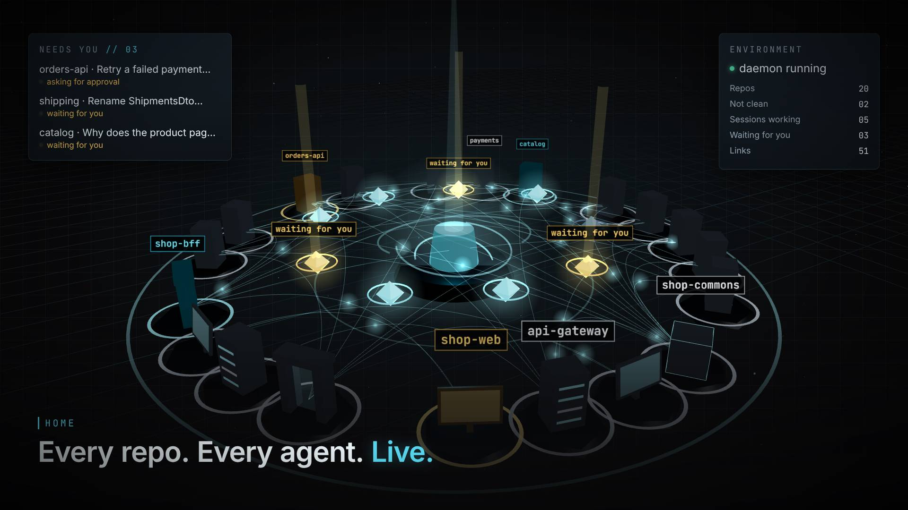
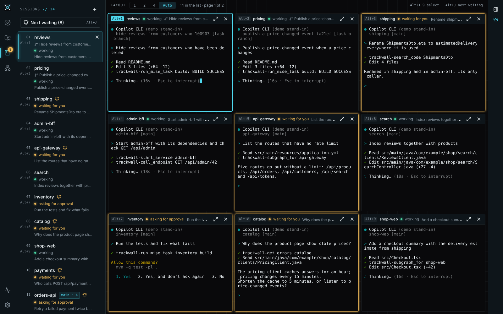
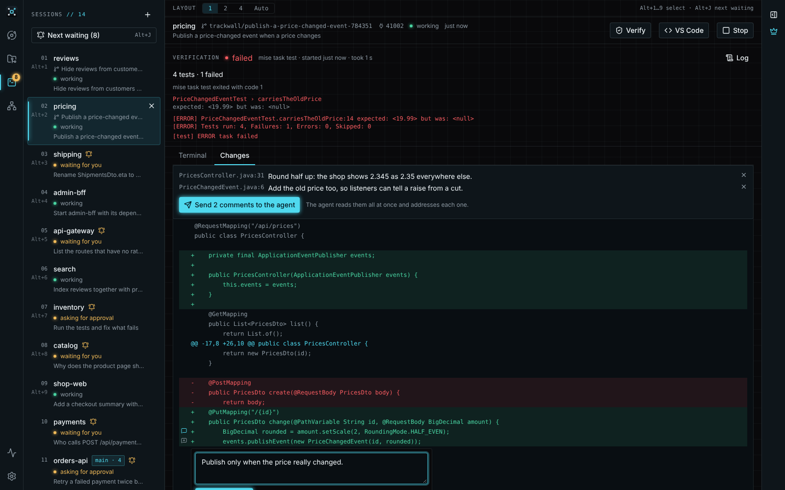
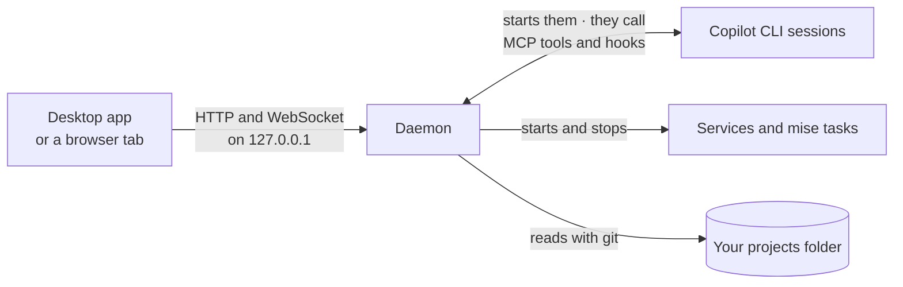

# Trackwall

**Many repos, many agents, one desk.** A desktop app for working across many git repositories and many CLI coding agents at once.

> [!NOTE]
> Trackwall is at a very early stage. Expect missing features, rough edges and breaking changes between versions.

## The problem

A system made of many repos is hard to keep in your head. One service calls three others, a library is built in a fourth repo, and the knowledge of who calls whom lives in code nobody has open. Coding agents make it faster to change one repo, but each sees only the folder it runs in, so you end up carrying the context between them, and watching five terminals to catch the one agent that is waiting for you.

Trackwall builds that knowledge once, from the code itself, and gives the same picture to you and to every agent: which repos there are, what each is made of, how they connect, what runs, and what waits for you.

## What it does

- **Keeps every repo in view.** Point it at your projects folder: it browses, clones and syncs every repo there, and builds a card of each one (stack, apps and ports, endpoints, packages, how to run it) from its files.
- **Draws the connection graph.** Which repo uses which, through shared packages and HTTP calls, each connection with the file and line that proves it, and which versions of Java, Spring Boot and build plugins the repos disagree on.
- **Runs Copilot CLI sessions side by side**, each in its own repo, and tells you which one is waiting for you or asking for approval, also from the tray.
- **Gives agents tasks on their own branch and worktree.** You review the diff, comment on lines and run its tests before anything lands.
- **Lends your agents the same picture** through its MCP server: code search across every repo, who calls an endpoint, logs and errors, services.
- **Starts services with the services they call**, in order, and waits until each one answers.
- **Has a supervisor**, one agent above all your repos that splits a change into one task per repo and follows them, after you approve.

<table>
  <tr>
    <td width="50%"></td>
    <td width="50%"></td>
  </tr>
  <tr>
    <td>Several agents at once, and the ones that need you stand out.</td>
    <td>Each task on its own branch, reviewed before it lands.</td>
  </tr>
</table>

Every feature has its own page on the [documentation site](https://jakubprill.github.io/trackwall/), and [Why Trackwall](https://jakubprill.github.io/trackwall/guide/why-trackwall) goes problem by problem.

## How it works

Trackwall is two programs. The **daemon** is a background process (TypeScript on Bun) that does all the work: it reads your repos with git, runs Copilot CLI sessions, services and mise tasks, and serves the MCP server for the agents. The **desktop app** (Tauri) is the window, the tray and the notifications, and only a view of the daemon, so your sessions and services keep running when you close it.

- **Facts come from the code, not from a model.** The cards and the graph are read from build files, configuration and source, without building or indexing anything, and without a server or database.
- **One picture for you and your agents.** The views and the MCP tools ask the same daemon, so when you see a service is ready, an agent sees it too.
- **You stay in charge.** An agent can propose a task, but the task does not start until you press "Start task", and no agent gets a Trackwall tool that changes its settings or answers an approval. Every command Trackwall runs for an agent (a mise task, a service) is built from your configuration, never from a command line the agent sends. An agent's own shell is another matter, see the limits below.
- **On your computer, or in a container.** The daemon can also run in a Linux dev container next to repos kept in a Docker volume, and you use it from the browser or the desktop app through a forwarded port.

More in [How Trackwall works](https://jakubprill.github.io/trackwall/guide/how-it-works) and the [Security model](https://jakubprill.github.io/trackwall/guide/security-model).

## Quick start

1. Download the build for Windows or macOS from [Releases](https://github.com/jakubprill/trackwall/releases). The builds are not signed yet, so follow the [installation steps](https://jakubprill.github.io/trackwall/guide/install) to get past SmartScreen and Gatekeeper.
2. Start Trackwall and set your projects folder in "Settings".
3. Install [GitHub Copilot CLI](https://github.com/github/copilot-cli) and [connect it](https://jakubprill.github.io/trackwall/guide/connect-copilot-cli) to Trackwall's MCP server.
4. Start a session from "Sessions", or ask your own Copilot CLI which repos call one of your services.

To run Trackwall in a container instead, see [Run in a dev container](https://jakubprill.github.io/trackwall/guide/dev-container). To build it from source, see [docs/development.md](docs/development.md).

## Limits today

- **Copilot CLI only.** Sessions, tasks and the supervisor run Copilot CLI; other agents can use the MCP tools, but get no sessions or approvals in the app.
- **Windows and macOS** for the desktop app. On Linux, Trackwall runs in a dev container.
- **Agents run as you.** An agent's commands run with your rights, as in your own terminal. An agent task without approvals can run in Copilot CLI's sandbox: on by default on Linux, also in a dev container set up for it, and on Windows and macOS when you turn it on. In any other dev container only the container keeps agents away from your computer, not from your other repos and sign-ins in it.
- **The card and the graph know Maven, Gradle and npm builds, Spring Boot, and HTTP endpoints and clients in Java and Kotlin.** Other stacks get their mise tasks but no endpoints or connections, and messaging such as Kafka does not show in the graph.
- **One person, one computer.** No shared server or team view.

The full list is in [Limits today](https://jakubprill.github.io/trackwall/guide/limits).

## License

MIT, see [LICENSE](LICENSE). Report vulnerabilities privately as described in [SECURITY.md](SECURITY.md).
