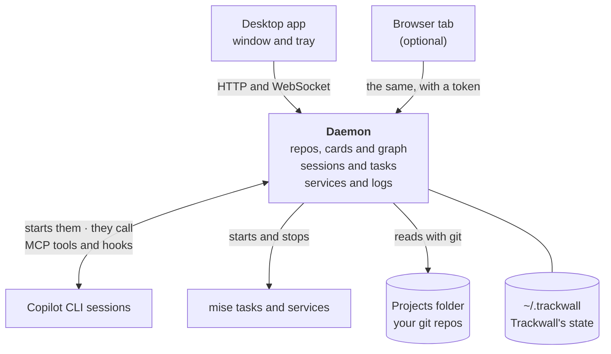
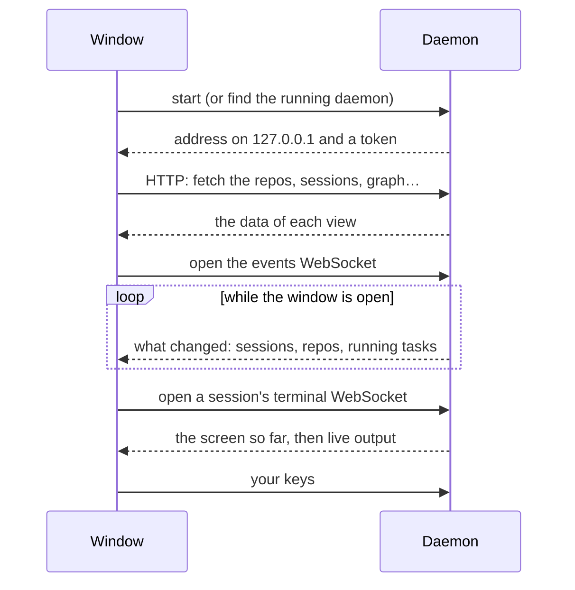
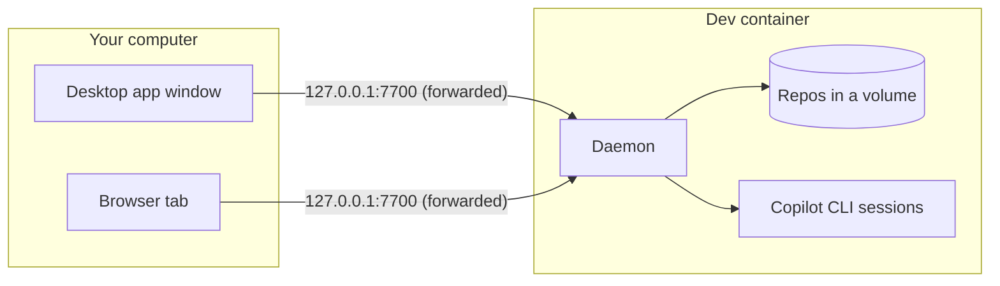
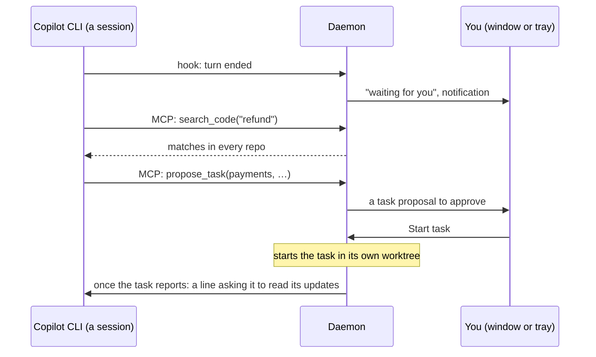
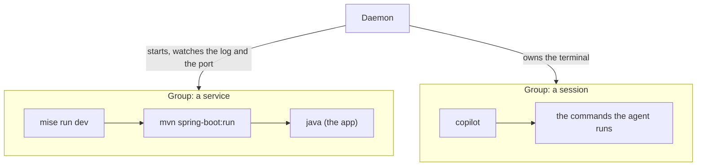

# How Trackwall works

The parts of Trackwall, which of them does what, and how the window, the browser and the agents talk to the background process that holds everything.

Trackwall is two programs. The **desktop app** is the window, the tray icon and the system integration. The **daemon** is a background process that does all the work: it reads your repos, runs Copilot CLI sessions, services and mise tasks, and answers the agents. The window is only a view of the daemon, which is why your sessions and services keep running when you close it.

## The parts

| Part | What it does | Runs when the window is closed |
|---|---|---|
| Desktop app | The window, the tray icon and its panel, notifications, the global shortcut, start at sign-in, updates. It starts the daemon, or connects to one in a [dev container](/guide/dev-container). | Yes, in the tray |
| Daemon | Everything else: the repo list, cards and graph, sessions and tasks, services, logs, the MCP server. One process, the single source of truth. | Yes |
| Copilot CLI sessions | Each agent is Copilot CLI in a terminal the daemon owns (or, in "Chat (preview)", a conversation), in a repo, a task's worktree or your projects folder. | Yes |
| Services and mise tasks | Your own programs, started by the daemon with mise, each with everything it starts in one group. | Yes |

## One source of truth

Everything you see and everything an agent learns comes from the daemon. The views ask it over HTTP and get live updates over a WebSocket; agents ask it through the MCP server. Because they all ask the same process, the dashboard and an agent see the same state: when "Services" says a service is ready, an agent calling `list_services` gets the same answer.

The daemon also decides what actually runs. A view or an agent never sends a command line; it names a repo, a task, a service or a mise task, and the daemon builds the command from your configuration. The one exception is a session's terminal, where you type as in any terminal.

## How the window talks to the daemon

- **Finding the daemon.** When the daemon starts, it writes its port and a fresh token to a file only you can read. The desktop app reads it and hands the token to the window. Nothing to configure.
- **Commands and questions** go over HTTP: one request per action, such as "list the repos", "start this task" or "stop this service". Both sides check every request and answer against the same shared definitions, so they cannot disagree about what a request means.
- **Live updates** come over one WebSocket for what changes often: the sessions, the repos' commits, the running mise tasks. When one changes, the daemon sends its new state and the views redraw. Other views refresh on a timer.
- **Terminals** have a WebSocket each. The daemon keeps every session's screen, so a terminal you open later, or in a second window, shows everything so far and then follows live.
- **The conversation view** of a session ("Chat (preview)") is one more WebSocket that carries the messages instead of a screen.

### In a browser, or in a container

The window is a web page, so the same page also works in a browser tab. The daemon serves it itself, at an address with the token after a `#`, which the browser never sends anywhere. When Trackwall runs in a [dev container](/guide/dev-container), the container's port is forwarded to your computer, and you open that address in the browser, or point the desktop app at it under "Daemon in a container" in "Settings > App".

## How agents talk to the daemon

A session you start in Trackwall gets two connections to the daemon, set up before Copilot CLI starts:

- **The MCP server.** Copilot CLI connects to the daemon's MCP server over HTTP and gets its tools: repos and cards, the graph, code search, logs and errors, services, sessions and tasks, the plan. Each session gets its own token, so the daemon knows which session is calling: a task can report only its own result, and a session runs mise tasks only in its own repo.
- **Hooks.** Copilot CLI tells the daemon what it is doing: a turn started, a tool ran, the agent stopped. With that, and with what it reads on the session's screen, the daemon shows "working", "waiting for you" or "asking for approval", and finds the approval question it shows in the tray panel.

Copilot CLI you run yourself, outside Trackwall, can use the same tools after you [connect it](/guide/connect-copilot-cli) once. It reaches the daemon through a small bridge command that finds the daemon's address and token by itself, so a restart of Trackwall needs no change on the agent's side.

## How processes run

Everything that runs for you, a Copilot CLI session, a mise task or a service, starts as a **process group**: the program with every process it starts in turn. `mise run dev` that runs Maven, which runs Java, is one group. Stopping it stops the whole group, and Trackwall says "stopped" only after it has checked that no process of the group is alive and, for a service, that its port is closed.

A stop is gentle first, then forceful: the group gets the signal to end, and after a few seconds everything left in it is killed. When the daemon itself ends, it stops every group; if it was killed instead, the next start cleans up what it left. On Windows a group is a job object, on macOS and Linux a process session. A program that deliberately leaves its group, the way a daemon process does, is out of reach of the stop, as it would be from your terminal.

When you quit Trackwall and start it again, or it updates, the sessions that were running come back on their own with their conversations.

## Where things live

- **Your projects folder** holds your repos and one `.trackwall` folder with the tasks' worktrees, your local config backup and the plan. [Where agents work](/guide/where-agents-work) shows it.
- **`~/.trackwall`** holds Trackwall's own state: settings in `workspace.yaml`, the list of tasks, cached repo cards and logs. [Config files](/features/config-files) lists every file.

There is no database: the files are plain JSON, YAML and Markdown you can read.

## Read on

- [Key flows](/guide/key-flows): a session, a task, the supervisor and a service, step by step.
- [Security model](/guide/security-model): what keeps an agent within bounds.
