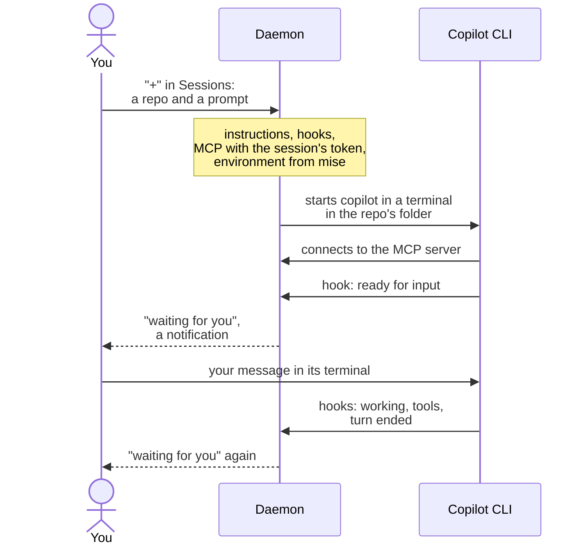
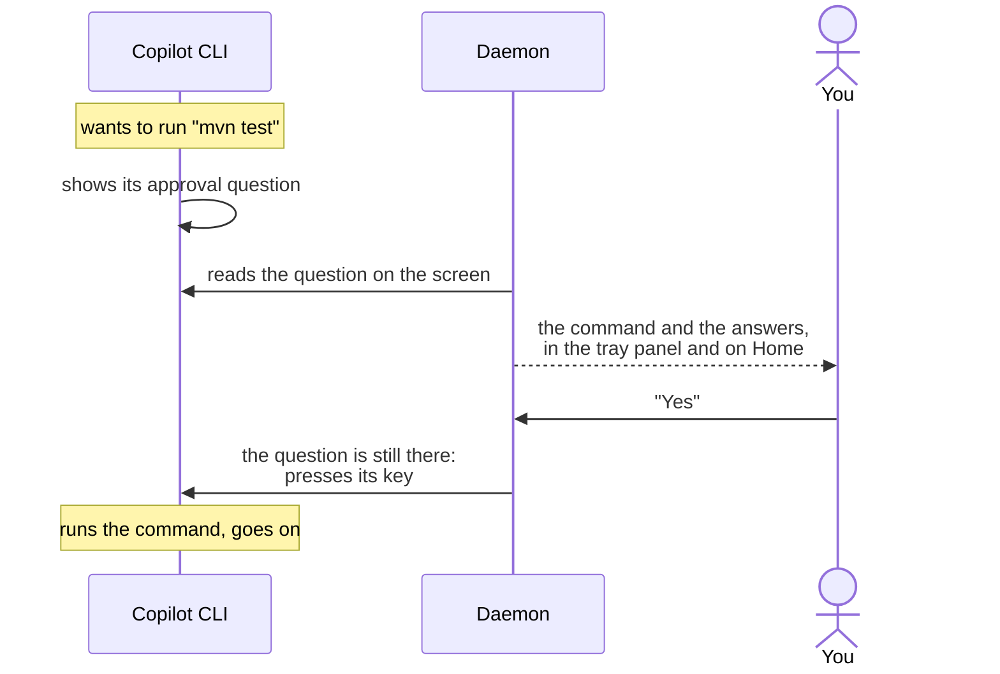
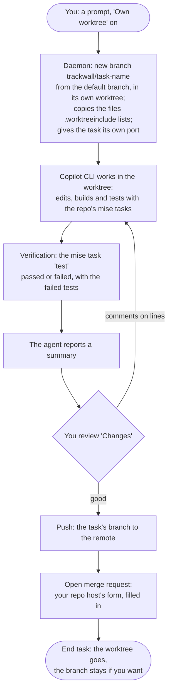
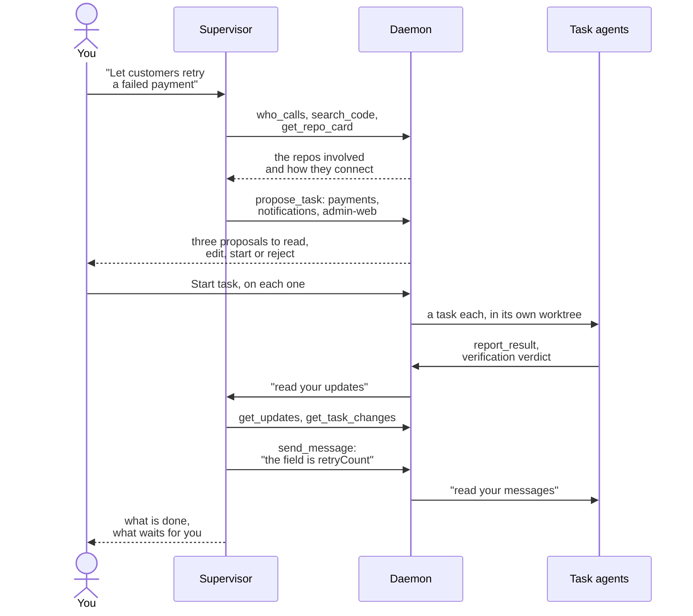
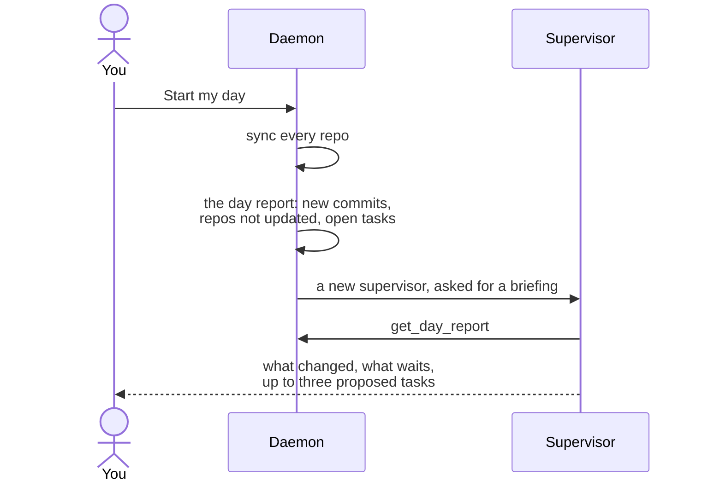
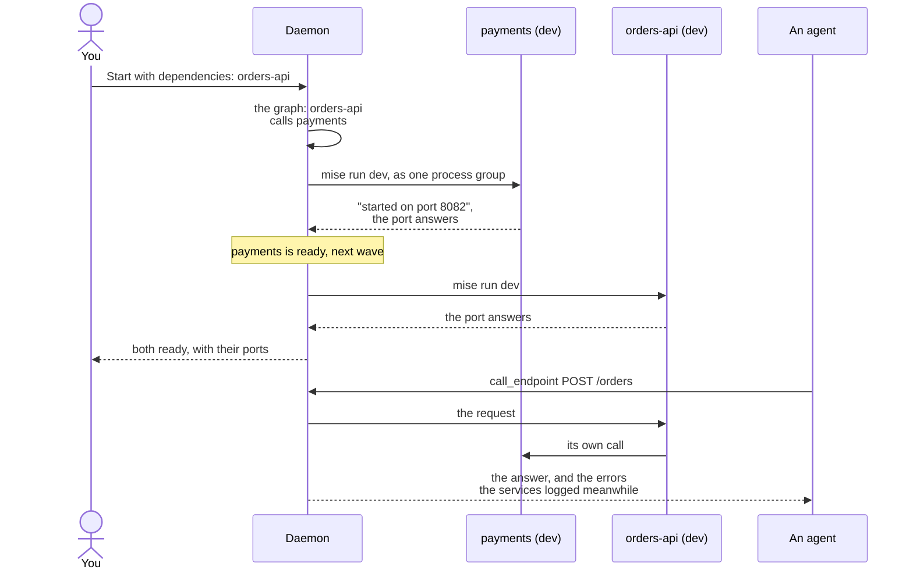

# Key flows

What happens, step by step, when you open a session, answer an approval, run an agent task, let the supervisor delegate, start your day or start a service.

Each flow below is a diagram with a few sentences around it. "Daemon" is Trackwall's background process, which does the work; [How Trackwall works](/guide/how-it-works) introduces it and the other parts.

## Opening a session

The daemon starts Copilot CLI itself, so every session is connected to Trackwall from its first second: it can use the [MCP tools](/features/mcp), it gets [short instructions](/features/session-instructions) on how to work with you, and its state reaches the list without you watching its terminal. The terminal belongs to the daemon, so closing the window does not end the session. See [Copilot CLI sessions](/features/sessions).

## Answering an approval outside the terminal

The click does exactly what the key in the terminal does, and only while the question you saw is still there. Commands you always allow or always refuse go into `toolPermissions` once and are never asked about. See [Approvals outside the terminal](/features/approvals).

## An agent task, from prompt to merge request

Your own working copy is never touched: the agent has its own folder on its own branch, and it runs services on its own port, so you can keep working next to it. The agent is told not to push: you push its branch with "Push". See [Agent tasks](/features/tasks) and [Where agents work](/guide/where-agents-work).

## The supervisor hands work to other agents

The supervisor runs in your projects folder, sees every repo, and does not change code itself. It plans and proposes, and you decide what starts. While the tasks run it is woken when one of them moves, so it can check the work and steer it. After five messages to a task without you, it has to ask you first. See [Supervisor](/features/supervisor) and [Main session and task proposals](/features/main-session).

## Start my day

See [Start my day](/features/start-my-day) and [Repos](/features/repos) for how syncing keeps your work safe.

## Starting a service with its dependencies

Each service starts only after the services it calls are up, a dependency that cannot start is skipped with the reason, and "Stop with dependencies" stops only what this start brought up. An agent does the same with `start_service` and `call_endpoint`. See [Services](/features/services).

## Read on

- [Security model](/guide/security-model): what an agent can and cannot do in these flows.
- [All features](/features/): every feature on its own page.
